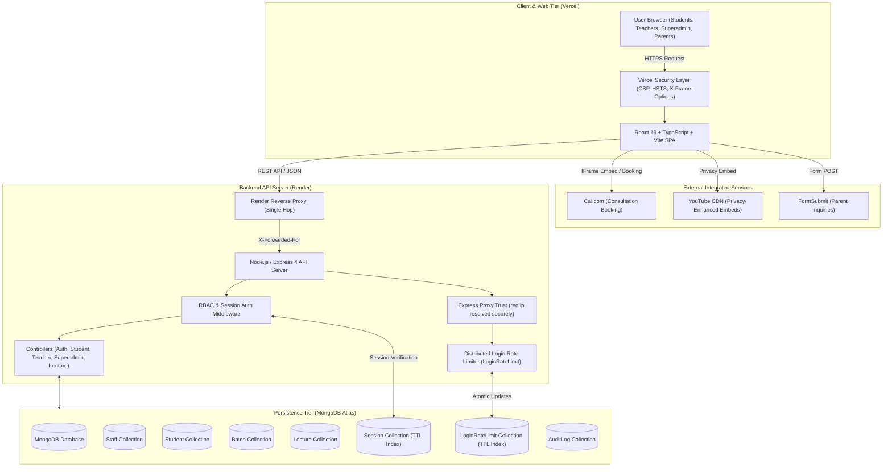
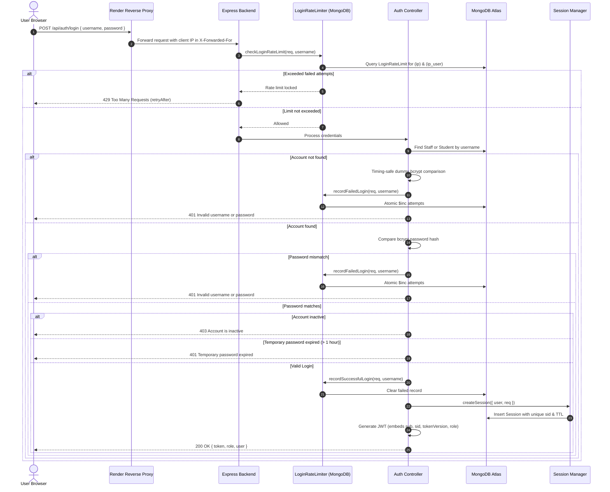
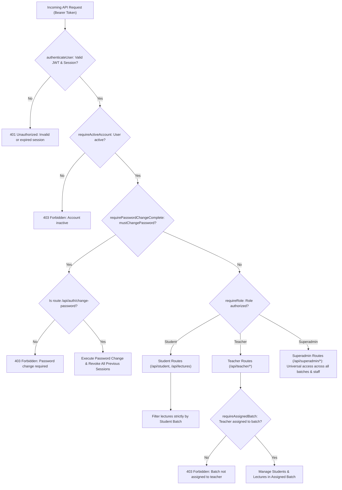
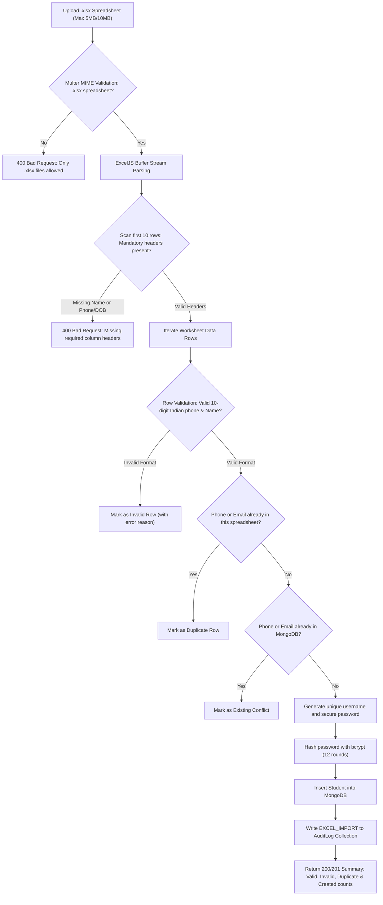

# Antariksh Academy — Institute Management & Lecture Portal System

Official web platform for **Antariksh Academy Coaching Institute** (Bijipur, Brahmapur, Odisha), featuring a responsive public institute website, Cal.com consultation booking, parent callback inquiry system, and a **Role-Based Management & Lecture Portal** supporting three distinct user tiers:

1. **`student`**: Enrolled students access batch-isolated recorded lectures and profile records.
2. **`teacher`**: Faculty administrators manage student rosters and lecture metadata for assigned batches.
3. **`superadmin`**: Institute leadership exercises master oversight across all batches, teachers, students, lectures, and audit logs.

---

## 1. System Architecture & Component Workflow

The platform follows a decoupled client-server architecture deployed across modern cloud services:
- **Frontend Client**: React 19 + TypeScript + Vite + Tailwind CSS deployed on **Vercel** with a hardened Content Security Policy (CSP).
- **Backend API**: Node.js + Express 4 REST API deployed on **Render** behind a single reverse proxy layer.
- **Database**: **MongoDB Atlas** storing all application entities, atomic rate-limiting counters, and session states.
- **Integrated Services**: YouTube for video playback, Cal.com for consultation scheduling, and FormSubmit for parent inquiry delivery.



---

## 2. Authentication, Rate Limiting & Session Lifecycle

The platform enforces zero-trust credential verification with proxy-aware rate limiting, timing-safe validation, and stateful session revocation without requiring Redis.



### Key Security Features
- **Proxy-Aware Rate Limiting**: Express is configured with `app.set('trust proxy', 1)`. Real client IPs are resolved safely from Render's reverse proxy, preventing spoofed `X-Forwarded-For` injection.
- **Victim DoS Protection**: Failed login tracking isolates `(IP + username)` pairs rather than locking accounts globally. An attacker guessing passwords on an account cannot lock out the legitimate user logging in from their home or mobile network.
- **Fail-Safe In-Memory Fallback**: If MongoDB connection is temporarily lost, an internal bounded in-memory `Map` (capped at 1,000 entries) takes over immediately to prevent failing open.
- **Redis-Free Session Revocation**: Sessions are stored in the MongoDB `Session` collection with TTL indexes. When a user logs out (`/api/auth/logout`), changes their password (`/api/auth/change-password`), or is deactivated by an administrator, sessions are revoked immediately in the database.

---

## 3. Role-Based Access Control (RBAC) & Batch Isolation

Every API endpoint enforces strict middleware checks to maintain batch isolation and role separation:



| Role | Accessible Frontend Routes | Key Backend Permissions & Isolation |
| :--- | :--- | :--- |
| **`student`** | `/student/*` | Stream recorded lectures strictly for enrolled batch; view profile; change personal password. |
| **`teacher`** | `/teacher/*` | Manage students and lectures **strictly within assigned batches** (`requireAssignedBatch`); bulk import via Excel; update profile. |
| **`superadmin`** | `/superadmin/*`, `/teacher/*` | Master oversight: batch creation, teacher provisioning, password reset, cross-batch student management, and audit log inspection. |

---

## 4. Bulk Excel Student Import Workflow

Both Teachers (scoped to an assigned batch) and Superadmins (for any batch) can import students in bulk using Microsoft Excel (`.xlsx` files):



### Import Features
- **Flexible Header Matching**: Automatically identifies synonyms (e.g. `phone`, `mobile`, `contact`, `phonenumber`).
- **In-Sheet Deduplication**: Flags duplicate phone numbers and emails before database interaction.
- **Safe Fallbacks**: Missing optional fields (e.g. college, address) are gracefully defaulted to `"N/A"` without failing the import.
- **Deterministic Username Generation**: Automatically creates human-readable usernames (e.g. `chandan.kumar.dalai`) with collision counters.

---

## 5. Repository Architecture

```text
antariksh-academy/
├── .gitignore                    # Universal root gitignore (protects credentials and secrets)
├── README.md                     # Master architecture, workflow & deployment documentation
│
├── frontend/                     # React 19 + TypeScript + Vite + Tailwind CSS Frontend
│   ├── src/
│   │   ├── components/           # UI Components & Role Protection
│   │   │   ├── auth/             # ProtectedRoute with role enforcement & 403 fallback
│   │   │   ├── common/           # CredentialsModal for one-time temporary passwords
│   │   │   ├── superadmin/       # Superadmin navigation & management views
│   │   │   └── teacher/          # Teacher navigation & batch views
│   │   ├── config/               # Public API & Academy Configurations
│   │   ├── context/              # AuthContext (stateful session) & ThemeContext
│   │   ├── data/                 # Course catalog, faculty profiles & testimonials
│   │   ├── pages/                # Public Institute & Role Portal Pages
│   │   │   ├── student/          # Student Login, Lectures, Profile, Change Password
│   │   │   ├── teacher/          # Teacher Dashboard, Students, Lectures, Profile
│   │   │   └── superadmin/       # Superadmin Dashboard, Batches, Teachers, Students, Logs
│   │   ├── services/             # FormSubmit admissions submission
│   │   ├── utils/                # Validation & date formatting helpers
│   │   ├── App.tsx               # Route declarations & synchronized transitions
│   │   └── main.tsx              # Application entry point
│   ├── public/                   # Logos, faculty assets, favicon
│   ├── package.json              # Frontend scripts & dependencies
│   ├── vite.config.ts            # Vite build configuration
│   ├── tsconfig.json             # TypeScript configuration
│   ├── vercel.json               # Security headers & Content Security Policy (CSP)
│   ├── .env                      # Local frontend variables (git-ignored)
│   └── .env.example              # Public frontend environment template
│
└── backend/                      # Node.js + Express + MongoDB REST API
    ├── src/
    │   ├── config/               # Database connection & fail-closed env validation
    │   ├── controllers/          # Auth, Teacher, Superadmin & Lecture controllers
    │   ├── middleware/           # Auth, RBAC, Active Account & Sanitized Error Handler
    │   ├── models/               # Staff, Student, Batch, Lecture, Session, LoginRateLimit, AuditLog
    │   ├── routes/               # Modular Express API Routes
    │   ├── services/             # Excel template generation & streaming parser (ExcelJS)
    │   ├── utils/                # Rate limiter, Session manager, YouTube validator, Token generator
    │   ├── app.js                # Express app with Helmet, CORS allowlist & Proxy configuration
    │   └── server.js             # Server startup & graceful shutdown handlers
    ├── data/
    │   ├── students/             # Initial student JSON data
    │   └── staff.json            # Initial faculty definitions
    ├── scripts/
    │   ├── seedStudents.js       # Student seeding script
    │   └── seedStaff.js          # Idempotent staff bootstrap script
    ├── tests/                    # Automated Node.js test suites
    │   ├── unit.test.js          # Unit tests (Tokens, YouTube, Excel)
    │   └── security.test.js      # Security tests (Rate limits, Sessions, ReDoS, Error leaks)
    ├── package.json              # Backend dependencies & test scripts
    ├── .env                      # Local backend variables (git-ignored)
    └── .env.example              # Documented backend environment template
```

---

## 6. Quick Start & Local Development

### Prerequisites
- **Node.js**: v18+ (tested on Node.js v24.x)
- **MongoDB**: Local MongoDB community instance or [MongoDB Atlas](https://www.mongodb.com/atlas) cluster URI

### Step 1: Install Dependencies
```bash
# 1. Install frontend dependencies
cd frontend
npm install

# 2. Install backend dependencies
cd ../backend
npm install
```

### Step 2: Configure Local Environment Variables
Create `.env` in both folders using the provided `.env.example` templates:

```bash
# Frontend
cp frontend/.env.example frontend/.env

# Backend
cp backend/.env.example backend/.env
```

### Step 3: Run the Development Servers

**Terminal 1 (Backend API):**
```bash
cd backend
npm run dev
# Server starts on http://localhost:5000
# Health check: http://localhost:5000/api/health
```

**Terminal 2 (Frontend Client):**
```bash
cd frontend
npm run dev
# Vite dev server starts on http://localhost:5173
```

---

## 7. Production Deployment Guidelines

### 7.1 Backend on Render
In the Render Dashboard under **Environment**:

1. `NODE_ENV`: Set to `production`.
2. `PORT`: `5000` (or Render default).
3. `MONGODB_URI`: Production MongoDB Atlas connection string.
4. `JWT_SECRET`: A 64-character cryptographically secure key (e.g. generated via `openssl rand -hex 32`). Must be at least 32 characters and not a placeholder.
5. `TRUST_PROXY`: `1` (Render uses 1 reverse proxy layer).
6. `FRONTEND_URL`: `https://antarikshacademy.vercel.app`.
7. `ALLOWED_ORIGINS`: `https://antarikshacademy.vercel.app`.
8. `BCRYPT_SALT_ROUNDS`: `12`.
9. `SUPERADMIN_USERNAME` & `SUPERADMIN_PASSWORD`: Strong initial administrator credentials.

### 7.2 Frontend on Vercel
In the Vercel Dashboard:
1. `VITE_API_BASE_URL`: `https://your-backend-name.onrender.com/api`.
2. The provided [`frontend/vercel.json`](file:///home/chandan/Desktop/tutionWebsite/frontend/vercel.json) will automatically enforce Content Security Policy (CSP), `X-Frame-Options`, `X-Content-Type-Options`, and `Referrer-Policy`.

---

## 8. Automated Verification & Testing

The project includes automated test coverage across all core functionality and security remediations:

```bash
# Run all backend unit and security tests (34 tests across 8 suites)
cd backend
npm test

# Verify frontend TypeScript types and production build
cd ../frontend
npm run build
```

All 34 automated tests run in <300ms:
- **Rate Limiting & Proxy Safety**: IP detection, spoof resistance, victim DoS protection, shared NAT isolation.
- **YouTube Validation**: Strict HTTPS, exact domain whitelist, 11-char ID validation.
- **ReDoS Prevention**: Escapes all regex metacharacters, bounds query lengths to 64 chars.
- **Session Lifecycle**: MongoDB token binding, single session logout, bulk revocation on password change.
- **Sanitized Errors**: Zero stack traces or internal database leaks in production responses.
- **Excel Import**: Column header mapping, in-sheet deduplication, template generation.
